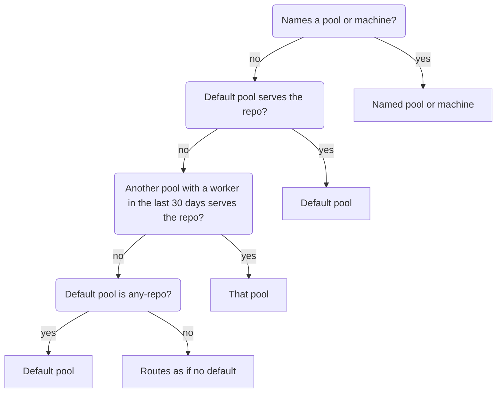

> 原文：https://cursor.com/docs/cloud-agent/self-hosted/pool

# Team Pools

池是一个具名路由目标，把请求连接到 [自托管机器](https://cursor.com/docs/cloud-agent/self-hosted.md) worker。请求在池中等待，直到有可用的 worker 认领它们。为不同的执行环境创建单独的池，例如一个用于需要 GPU 的工作，另一个用于需要 Mac 的工作。

Team Pools 面向希望 Cloud Agents 在公司管理的基础设施内运行的 Enterprise 团队。管理员运营一个 worker 池，可以把 Agent 分配给整个组织，而不是每个开发者在个人机器上启动 worker。

池是一种基础设施所有权选择。它们不会把 Agent 循环移出 Cursor 的云。Worker 在你的基础设施中执行终端命令、文件编辑、浏览器操作和其他工具调用，而 Cursor 负责编排、模型访问和 Cloud Agent 体验。

Cursor 管理的 Cloud Agents 是大多数团队的推荐路径，包括需要私有网络访问的团队。在接手运维一个 worker 集群之前，请对受支持的源代码管理路径使用带网络控制的托管环境、Tailscale 或类似客户端，或私有连接。见[选择 Cloud Agents 的运行位置](https://cursor.com/docs/cloud-agent/self-hosted/choose-runtime.md)。

在以下情况使用池：

- 为团队或组织集中管理 worker
- 使用服务账号身份验证，而不是个人浏览器登录
- 需要 Kubernetes、自动扩缩或集中管理的容量
- 用标签把工作路由到合适的环境、团队、仓库或硬件配置
- 由公司拥有的主机，用于工具执行、构建输出、worker 日志和监控

若要快速完成个人设置，见 [My Machines](https://cursor.com/docs/cloud-agent/self-hosted/my-machines.md)。池所需的计划、凭证、仪表盘设置和机器依赖，见自托管机器概览上的[要求](https://cursor.com/docs/cloud-agent/self-hosted.md#requirements)。

## 工作原理

Worker 打开一条到 Cursor 云的长期出站 HTTPS 连接。Agent 循环（包括推理和规划）在 Cursor 的云中运行，并通过这条连接发送工具调用。Worker 在你的基础设施中执行这些工具调用：终端命令、文件编辑、浏览器操作，以及对内部服务的访问。

你的仓库、构建缓存、密钥和工具执行留在你的环境中，而 Cursor 负责编排、模型访问和 Cloud Agent 体验。Cloud Agent [产物](https://cursor.com/docs/cloud-agent/self-hosted/pool.md#artifacts)（例如截图和视频）会上传到 Cursor，以便你在 PR 和仪表盘中查看。

Worker 只需要出站访问。不需要入站端口、公共 IP 或 VPN 隧道。所需主机的完整列表见[网络](https://cursor.com/docs/cloud-agent/self-hosted/pool.md#networking)。

自托管机器每个用户最多支持 200 个 worker，每个团队最多 1000 个。对于更大的全公司部署，[联系我们](https://cursor.com/contact-sales?source=self-hosted-agents)讨论扩容。

## 前提条件

- **Cursor Enterprise 计划**
- 由团队管理员在 [Cloud Agents 仪表盘](https://cursor.com/dashboard/cloud-agents#self-hosted)中配置的自托管设置：
  - **Allow Self-Hosted Machines** 让用户可以选择加入自托管运行。
  - **Require Self-Hosted Machines** 把每一次 Cloud Agent 运行都路由到自托管 worker。
- 用于池 worker 身份验证的[服务账号 API 密钥](https://cursor.com/docs/account/enterprise/service-accounts.md)
- 一台 worker 机器或镜像，具备：
  - 已安装 `agent` CLI
  - 已安装 `git` 且在 `PATH` 上可用（当 worker 服务 git 远程，或使用 [`--clone-git-repos`](https://cursor.com/docs/cloud-agent/self-hosted/pool.md#any-repo-pools) 时必需；如果由你自己的脚本处理 SCM，则对[任意仓库池](https://cursor.com/docs/cloud-agent/self-hosted/pool.md#any-repo-pools)可选）
  - 一个工作区目录（带已配置远程的已克隆仓库，或一个[任意仓库](https://cursor.com/docs/cloud-agent/self-hosted/pool.md#any-repo-pools)目录）
  - 能够访问你的 Agent 所需的构建工具、包注册表、密钥和内部服务

## 安装 CLI

```bash
# macOS, Linux, and WSL
curl https://cursor.com/install -fsS | bash

# Windows PowerShell
irm 'https://cursor.com/install?win32=true' | iex
```

Windows worker 需要 [Git for Windows](https://git-scm.com/download/win)，包括 Git Bash。没有它，worker 不会启动。

确认 CLI 可用：

```bash
agent --version
```

## 为 worker 进行身份验证

池 worker 使用[服务账号 API 密钥](https://cursor.com/docs/account/enterprise/service-accounts.md)进行身份验证，或使用从该密钥为单次认领签发的[会话 token](https://cursor.com/docs/cloud-agent/self-hosted/pool.md#session-tokens)。

用户、个人、团队和组织 API 密钥都不能启动池 worker。请把个人或用户 API 密钥用于 [My Machines](https://cursor.com/docs/cloud-agent/self-hosted/my-machines.md) 上的个人 worker。

```bash
export CURSOR_API_KEY="your-service-account-api-key"
```

你也可以直接传入该密钥：

```bash
agent worker --api-key "your-service-account-api-key" start
```

## 启动池 worker

从它应当服务的工作区运行 worker（git 仓库根目录，或一个[任意仓库](https://cursor.com/docs/cloud-agent/self-hosted/pool.md#any-repo-pools)目录）：

```bash
cd /path/to/repo
agent worker --pool start
```

`--pool` 把 worker 注册为接受池分配。传入一个可选名称以加入具名池（例如 `--pool my-pool`）。省略名称时，worker 加入 `default`。每个 Cloud Agent 会话一次认领一个 worker。

对于编排环境，把它与 `--idle-release-timeout` 组合使用，这样工作完成后进程会干净退出：

```bash
agent worker --pool my-pool --idle-release-timeout 600 start
```

`--idle-release-timeout` 让 worker 在会话结束后的一段窗口期（以秒计）内保持存活，以便处理后续消息。默认是 `3600` 秒。释放与重连如何工作，见[会话生命周期](https://cursor.com/docs/cloud-agent/self-hosted/pool.md#session-lifecycle)。

### 启用 Computer Use

传入 `--computer-use`，这样被认领的 Agent 就能在 worker 上点击、键入、截屏并驱动应用：

```bash
agent worker --pool my-pool --computer-use start
```

在 macOS 上，首次启动会安装 **Cursor Computer Use** 辅助应用。授予它 **Accessibility** 和 **Screen Recording**，用一个会截屏的任务验证，然后为机器制作快照，这样从该镜像恢复的每个 worker 都已就绪。在 Linux 上，把桌面包烘焙进 worker 镜像。macOS 权限步骤、MDM 配置文件指导以及 Linux 显示选项，见 [Computer Use 与桌面共享](https://cursor.com/docs/cloud-agent/self-hosted/computer-use.md)。

### 打开实时工作区

在 Linux worker 上传入 `--connect-workspace`，这样在 Cursor 桌面应用中打开自己 Agent 的人就能得到该 Agent 的文件、改动、终端和转发的端口。它需要 Cursor 3.25 或更高版本，并给这些人一个以 worker 的操作系统用户身份运行的终端。开启之前，阅读[实时工作区](https://cursor.com/docs/cloud-agent/self-hosted.md#live-workspace)，了解谁可以打开它。

```bash
agent worker --pool my-pool --connect-workspace start
```

## 注册多个仓库根目录

当 worker 应当服务你在它启动之前克隆的检出时，注册多个根目录。为每个本地仓库根目录传入一次 `--worker-dir`。第一个根目录是用于分配身份和仪表盘显示的主仓库。所有根目录都会暴露给 Agent 运行时，具有有效 git origin 的根目录会注册仓库路由元数据。

额外的根目录不会给请求增加仓库。[创建 Agent](https://cursor.com/docs/cloud-agent/api/endpoints.md#create-an-agent)对 `default` 池或由仓库支持的池接受一个仓库。Agent 可以在其他根目录中工作，但那里的 git 使用 worker 上已经存在的凭证。签发的 GitHub token 只覆盖请求中的仓库。要用多个仓库启动一个 Agent，把它们发给 worker 以 `--clone-git-repos` 运行的[任意仓库池](https://cursor.com/docs/cloud-agent/self-hosted/pool.md#any-repo-pools)。

`--worker-dir` 最多可重复 20 个路径。每个路径必须已经存在并且是目录。如果你不传 `--worker-dir`，CLI 使用当前工作目录。

开始之前，在 **Dashboard** > **Cloud Agents** > **Self-Hosted** 中启用自托管 worker。除非你自己的机器镜像保证另一个可写位置，否则使用 `$HOME` 下的可写路径。

示例设置：

```bash
export WORKER_ROOT="$HOME/cursor-repos/my-org"
mkdir -p "$WORKER_ROOT"

git clone git@github.com:my-org/app.git "$WORKER_ROOT/app"
git clone git@github.com:my-org/infra.git "$WORKER_ROOT/infra"

export CURSOR_API_KEY="<key>"
```

在启动 worker 之前运行预检：

```bash
agent worker \
  --pool my-pool \
  --name app-infra-worker \
  --worker-dir "$WORKER_ROOT/app" \
  --worker-dir "$WORKER_ROOT/infra" \
  debug --json
```

用相同的根目录启动 worker：

```bash
agent worker \
  --pool my-pool \
  --name app-infra-worker \
  --worker-dir "$WORKER_ROOT/app" \
  --worker-dir "$WORKER_ROOT/infra" \
  start --verbose
```

把 worker 选项放在 `start` 或 `debug` 之前。让进程在 `systemd`、`tmux`、`launchd`、Kubernetes 或你自己的进程管理器等监督程序下持续运行。

详细启动日志是已注册根目录的事实来源。成功的多仓库 worker 会显示每个派生的仓库标签、工作区路径和仓库 URL：

```text
repo=my-org/app
repo=my-org/infra
workspacePaths: [app, infra]
x-repository-urls: ["git@github.com:my-org/app.git","git@github.com:my-org/infra.git"]
```

仪表盘目前把自托管 worker 显示在它的主仓库下。门户中还没有具名的自托管多仓库环境对象。这看起来可能像只注册了第一个仓库。在详细日志中检查 `workspacePaths` 和 `x-repository-urls`，以确认所有根目录。要把另一个仓库设为主仓库，把它的 `--worker-dir` 放在最前。

使用 `--name` 和 `--pool <name>`，让多仓库 worker 在仪表盘和触发器中易于识别。

在池模式下，一次由一个 Cloud Agent 认领该 worker。没有 `--pool` 时，允许共享分配。当你需要为编排器提供 `/healthz`、`/readyz` 和 `/metrics` 时，在 `start` 之前加上 `--management-addr 0.0.0.0:8080`。

非 git 目录可以作为执行根目录，但它们不贡献仓库路由元数据。对于多仓库 worker，在 worker 启动前克隆每个仓库。若要从空工作区开始，并让 worker 在分配之后引导源代码管理，请使用[任意仓库池](https://cursor.com/docs/cloud-agent/self-hosted/pool.md#any-repo-pools)。

## 任意仓库池

池有两种仓库配置。由仓库支持的池把池绑定到一个或多个仓库：请求带有 `repo=<owner/repo>` 标签，匹配服务于该仓库的 worker，并出现在仪表盘中该仓库下。任意仓库池把源代码管理留给你：请求只按池名称匹配，池出现在仪表盘的 **Any repo** 下。

如果你更愿意自己管理源代码管理，创建一个不附加仓库的池。池 worker 不要求 git 远程。当你希望 Agent（或你自己的镜像、hooks 和脚本）管理克隆和 git 状态时，把 `--worker-dir` 指向任意已存在的目录：

```bash
mkdir -p "$HOME/cursor-sandboxes/default"
agent worker --pool my-pool --worker-dir "$HOME/cursor-sandboxes/default" start
```

要给每个任意仓库请求提供仓库说明，在传给 `--worker-dir` 的目录内的 `.cursor/rules` 下创建一个 `.mdc` 文件。文件名任意。此示例使用 `repo-info.mdc`：

```md title=".cursor/rules/repo-info.mdc"
---
alwaysApply: true
---

This any-repo worker can clone from `github.acme.internal` with the
pre-authenticated `gh` CLI.

- For requests about payments, billing, or checkout, use
  `platform/payments-service`. If it is missing, run:
  `GH_HOST=github.acme.internal gh repo clone platform/payments-service`
- For requests about the member portal or account settings, use
  `web/member-portal`. If it is missing, run:
  `GH_HOST=github.acme.internal gh repo clone web/member-portal`
- Clone only the repositories needed for the request. Run subsequent commands
  from the cloned repository.
- If no mapping matches the request, report that the repository is not
  configured. Do not guess a repository name, clone URL, or credentials.
```

[`alwaysApply: true`](https://cursor.com/docs/rules.md#rule-anatomy) 会把该规则包含进每个请求。把文件放在 worker 目录中，以便在克隆之前就可用，并用你的仓库和 SCM 命令替换示例映射。

要让 worker 在认领时检出被认领 Agent 的仓库，传入 `--clone-git-repos`。这是选择加入的。默认的任意仓库行为不会克隆。

```bash
agent worker --pool my-pool --clone-git-repos start
```

`--clone-git-repos` 隐含 `--mint-github-token`。克隆和获取使用该签发的短期 GitHub token，它覆盖请求中的每个仓库。团队管理员必须为 Team Pool worker 启用 GitHub token 签发，并且 `git` 必须在 `PATH` 上。

只在任意仓库池 worker 上使用此标志：具名 `--pool` 且不是 `default`，没有绑定的仓库（`repo=`），也没有绑定的机器（`name=`）。在绑定了仓库的 worker、具名机器、`default` 池或个人 [My Machines](https://cursor.com/docs/cloud-agent/self-hosted/my-machines.md) worker 上，CLI 会以明确错误退出。

分支名用 `--branch` 克隆。完整的 40 字符提交 SHA 在克隆后使用分离检出。使用 HTTPS GitHub 远程，以便签发的 token 可以进行身份验证。

如果 worker 目录，或其直接内部的某个文件夹，已经有被认领仓库的干净检出，worker 会复用它，而不是再次克隆。检出的 `origin` 远程必须指向同一主机和 `owner/repo`。Worker 获取所请求的分支、标签或提交并检出它，并且只对本地分支做快进。当它无法安全地更新检出时，会改为在该检出旁边克隆到一个新文件夹，例如检出具有以下情况时：

- 对已跟踪文件有未提交的改动
- 所请求分支上有远程所没有的本地提交
- 正在进行 merge、rebase、cherry-pick、revert 或 bisect
- 已设置子模块
- 有全新克隆不会具备的 Git 配置或 hooks

复用需要 git 2.26 或更高版本；git 更旧时，worker 会克隆。Worker 日志会说明它为什么复用或没有复用每个检出。

认领结束时，worker 删除它为该次认领克隆的仓库，并保留复用的检出。要避免在每次认领时克隆大型仓库，请在启动 worker 之前把它克隆到 worker 目录中。

如果克隆失败，请求留在队列中。运维人员看到的是一条通用的克隆失败。

`--clone-git-repos`、`--mint-github-token` 和 `--sync-dashboard-secrets` 假定每个容器或操作系统用户一个 worker。在同一用户下并置多个启用了凭证的 worker 不受支持。

任意仓库池省略 `repo=` 路由标签。用 `env.type: "pool"` 并把 `env.name` 设为池名称，针对它们启动 Agent（见[创建 Agent](https://cursor.com/docs/cloud-agent/api/endpoints.md#create-an-agent)）。省略 `repos`，或传入一个或多个供 Agent 工作的仓库。它们不会收窄由哪个 worker 认领该次运行。用 `--clone-git-repos` 启动的 worker 会检出其中每一个。如果你对这些仓库有写权限，Agent 可以打开并更新它们上的 pull request。这不适用于由服务账号创建的 Agent。在 [cursor.com/agents](https://cursor.com/agents) 的 **Any repo** 下选择该池。在 Slack 中，被设为[团队默认池](https://cursor.com/docs/integrations/slack.md#team-default-pool)或[频道默认池](https://cursor.com/docs/integrations/slack.md#channel-default-pool)的任意仓库池，即使从消息或默认值中解析不出仓库，也让 `@Cursor` 能够启动 Agent。

## 管理池

池是持久的。最后一个 worker 断开后，池仍保持已注册并可选择，因此你可以缩容到零，并在请求到达时把容量带回来。用新的池名称启动 worker 会隐式创建该池。用 [Cloud Agents API](https://cursor.com/docs/cloud-agent/api/endpoints.md#workers-and-pools) 提前管理池：

- [`POST /v0/private-workers/pools`](https://cursor.com/docs/cloud-agent/api/endpoints.md#register-a-pool) 在任何 worker 连接之前预先注册一个池。对于由仓库支持的池，包含 `repoOwner`、`repoName` 和 `repoUrl`；对于任意仓库池则省略它们。
- [`GET /v0/private-workers/pools`](https://cursor.com/docs/cloud-agent/api/endpoints.md#list-pools) 列出池，以及已连接和正在使用的 worker 计数。
- [`DELETE /v0/private-workers/pools`](https://cursor.com/docs/cloud-agent/api/endpoints.md#deregister-a-pool) 软删除一个池。它**不会**影响当前连接到该池的机器。

使用[列出池](https://cursor.com/docs/cloud-agent/api/endpoints.md#list-pools)和[待处理请求](https://cursor.com/docs/cloud-agent/api/endpoints.md#list-pending-pool-requests)来决定何时把 worker 扩回来。

## 池名称

当你希望会话路由到特定子集时，把池 worker 归到一个名称下，例如 GPU 机器、预发集群，或团队专用的构建机器。

把名称传给 `--pool`：

```bash
agent worker --pool my-pool start
```

省略名称时，worker 加入 `default` 池。只支持布尔 `--pool` 外加单独 `--pool-name` 的旧版 CLI 仍然可用；`--pool-name` 是 `--pool <name>` 的已弃用别名。

当编排器注入配置时，从环境变量设置池名称：

```bash
export CURSOR_WORKER_POOL_NAME=my-pool
agent worker --pool start
```

多用途 worker（启动时不带 `--pool`）不属于任何池。

从 [Cloud Agents 仪表盘](https://cursor.com/dashboard/cloud-agents) 启动会话或编辑自动化时，在 worker 选择器中挑选一个池。在自动化编辑器中，池选择器出现在你选择了特定环境或仓库之后。你也可以在 Slack、GitHub 或 Linear 触发器中包含 `pool=<name>`。会话只路由到以该池名称注册的 worker。

## 触发池 Agent

当你希望 Cloud Agent 在团队的共享 worker 集群上运行时，使用池触发器。池 worker 适合作为集中管理的容量、自动扩缩、类似 CI 的运行器，以及按仓库划分的基础设施的目标。

团队管理员从 [Cloud Agents 仪表盘](https://cursor.com/dashboard/cloud-agents) 的 Self-Hosted 部分控制自托管路由。**Allow Self-Hosted Machines** 让用户按请求选择加入。没有选择加入时，运行使用 Cursor 的托管基础设施。**Require Self-Hosted Machines** 把 Cloud Agent 运行路由到自托管 worker。Agent 保持它启动时所处的放置。该设置打开后，Cursor 会拒绝针对该团队中曾在 Cursor 托管基础设施上运行的 Agent 的后续消息，并要求你启动一个新 Agent 才能继续。

当 Cursor 启动一个池 Agent 时，它用标签匹配 worker。针对某个仓库的池请求包含 `repo=<owner/repo>` 标签；发往不带仓库的[任意仓库池](https://cursor.com/docs/cloud-agent/self-hosted/pool.md#any-repo-pools)的请求则省略它。具名池的请求还包含 `pool=<name>`。

池 worker 处理：

- 被 **Require Self-Hosted Machines** 覆盖的运行，除非请求用 `worker=` 或 `machine=` 指向某个特定的 My Machines worker
- 带有 `self_hosted=true` 或其短形式 `sh=1` 的请求
- 带有 `pool=<name>` 的请求，这同时选择该具名池
- 来自触发界面、带有仓库选择的自托管请求，例如在受支持的地方使用 `repo=<owner/repo>`

当被 **Require Self-Hosted Machines** 覆盖的运行没有指定池或机器，且没有池 worker 可以承接时，Cursor 改为在你自己已连接的 [My Machines](https://cursor.com/docs/cloud-agent/self-hosted/my-machines.md) worker 之一上运行它。绝不会使用队友的机器。

`repo=` 为该次运行选择仓库。对于 Team Pool 运行，该仓库成为 `repo=<owner/repo>` worker 标签。它并不指向某台个人机器。

从集成使用这些选项来启动池 Agent：

- **Slack**：提及 `@Cursor` 时带上 `self_hosted=true`、`sh=1` 或 `pool=<name>`。团队管理员可以用 `@Cursor pool set <name>` 设置[团队默认池](https://cursor.com/docs/integrations/slack.md#team-default-pool)，这样成员不必在每次提及中加选项就能在其上运行。任何团队成员都可以用 `@Cursor pool set <name> channel` 设置[频道默认池](https://cursor.com/docs/integrations/slack.md#channel-default-pool)，它会在该频道中取代团队默认池。显式的 `pool=`、`worker=`、`machine=` 或 `self_hosted=false` 会覆盖这两个默认值，而任意仓库默认池让 Slack 在没有解析出仓库时也能启动。
- **GitHub**：在 issue、pull request 或评审评论上评论 `@cursoragent self_hosted=true ...`、`@cursoragent sh=1 ...` 或 `@cursoragent pool=<name> ...`。
- **Linear**：在评论中提及 `@Cursor`，并带上 `self_hosted=true`、`sh=1`、`pool=<name>` 或 `[pool=<name>]`。Cursor 从该评论读取这些选项，而不是从 issue 描述中读取。你也可以使用父标签为 `pool`、子标签为池名称的 issue 或项目标签。当你把 issue [委派](https://cursor.com/docs/integrations/linear.md#delegating-issues)给 Cursor 时，标签是选择池的唯一方式，因为没有评论可读。评论中的 `pool=` 优先于池标签，而 `self_hosted=false` 会跳过池标签。

把每个选项写成 `key=value`。`self_hosted` 及其短形式 `sh` 接受 `true`、`t` 或 `1` 以选择加入，接受 `false`、`f` 或 `0` 以选择退出。其他任何内容都作为文本留在你的提示词里。这包括没有值的 `self_hosted`、`selfhosted` 或 `sh`，以及其他取值，例如 `sh=/bin/bash`。Slack、GitHub 和 Linear 都会忽略代码块内的这些选项，因此粘贴的代码不会改变 Agent 的运行位置。

策略如何处理，取决于请求从哪里发起：

- **Slack** 在 Allow Self-Hosted Machines 关闭时拒绝自托管选择加入，并在 Slack 中回复。如果 Require Self-Hosted Machines 打开，每一次 Slack 提及都以自托管方式运行。
- **GitHub** 让仓库的 `OWNER` 和 `COLLABORATOR` 用户把运行路由到自托管 worker。其他评论者在选择加入时于托管基础设施上运行；如果 Require Self-Hosted Machines 打开，则会被跳过。这保护了外部贡献者可以留下评论的公开仓库。
- **Linear** 在 Allow Self-Hosted Machines 关闭时拒绝显式的自托管请求。该 issue 会得到一条 Agent 活动错误，要求管理员打开自托管 worker，或去掉改为在 Cursor 托管基础设施上运行的提示。

要按名称指向你自己的某台机器，请使用带 `worker=` 或 `machine=` 的 [My Machines](https://cursor.com/docs/cloud-agent/self-hosted/my-machines.md#trigger-this-machine-from-a-chat-surface)。

Cloud Agent API 使用同一套解析器，字段为 `usePrivateWorker` 和 `labels`。端点详情见 [Cloud Agent API 文档](https://cursor.com/docs/cloud-agent/api/endpoints.md)。

### 默认池

团队管理员可以把没有点名某个池的自托管运行送到一个团队池。在 [Cloud Agents 仪表盘](https://cursor.com/dashboard/cloud-agents#self-hosted) 的 Self-Hosted 部分设置 **Default pool**。它在 **Allow Self-Hosted Machines** 打开后出现。选择器列出你团队的池，但会去掉最近 30 天没有 worker 连接过的池，以及你无法访问其仓库的、绑定了仓库的池。已保存的默认值会继续列出。选择 **None** 即可关闭。没有默认值时，路由与以前一样。

该默认值适用于没有点名池或机器的自托管运行，无论它们是自己选择加入的，还是由 **Require Self-Hosted Machines** 送到那里的。Cursor 按以下顺序路由每次运行：

1. **请求中点名的池或机器。** `pool=<name>`、`worker=` 和 `machine=` 始终优先。
2. **当默认池服务于该次运行的仓库时，使用默认池，** 即使另一个池也服务于该仓库。
3. **另一个服务于该仓库的团队池，** 如果它的某个 worker 在最近 30 天内连接过。
4. **当默认池是[任意仓库](https://cursor.com/docs/cloud-agent/self-hosted/pool.md#any-repo-pools)池时，使用默认池。** 它承接任何其他仓库的运行，以及没有仓库的运行。
5. **没有匹配。** 该运行按未设置默认值的方式路由。



被默认值承接的运行会在有限时间内等待该池的 worker，如果没有任何 worker 连接就失败。它绝不会回退到你自己的 My Machines worker。名为 `default` 的池只有在它服务于某个仓库时才符合条件，因为用 `--pool` 且不带名称启动的 worker 也会加入它。

默认值改变的是运行去往何处，而不是谁可以启动它：仓库访问检查（例如 API 密钥的仓库范围）仍然适用于请求所点名的仓库。

Slack 的[团队](https://cursor.com/docs/integrations/slack.md#team-default-pool)和[频道](https://cursor.com/docs/integrations/slack.md#channel-default-pool)默认池是单独的设置，并对 `@Cursor` 提及优先。当某个 Slack 默认值并不服务于该提及的仓库时，Slack 会拒绝该提及，而不是回退到这项设置。

## Hooks

自托管机器 worker 在 Cloud Agent 会话期间运行基于命令的 [hooks](https://cursor.com/docs/hooks.md)。它们从 worker 所服务的工作区加载配置。

- **项目 hooks。** 把 `.cursor/hooks.json` 及其引用的脚本提交到 worker 所使用的仓库或工作区目录中。那可以是 git 检出、一个 `--worker-dir` 根目录，或你为[任意仓库池](https://cursor.com/docs/cloud-agent/self-hosted/pool.md#any-repo-pools)传入的目录。
- **团队与 Enterprise 管理的 hooks。** 在 Enterprise 上，worker 也会运行在[网页仪表盘](https://cursor.com/dashboard/team-content?section=hooks)中配置的 hooks。
- **Worker 标志。** 池 worker 也接受 `--on-session-start <command>` 和 `--on-session-end <command>`。每个标志添加一条 `sessionStart` 或 `sessionEnd` 命令，而无需编辑 `.cursor/hooks.json`。

[Hooks](https://cursor.com/docs/hooks.md) 参考涵盖模式、事件和示例。[Cloud Agent 支持](https://cursor.com/docs/hooks.md#cloud-agent-support)列出 Cloud Agent 循环会运行哪些事件。

同样适用于这些工具执行 worker 的 Cloud Agent 限制：

- **仅基于命令的 hooks。** 基于提示词的 hooks 不会运行。
- **没有仅限 IDE 的 hooks。** Tab hooks（`beforeTabFileRead`、`afterTabFileEdit`）和 `workspaceOpen` 不会在 worker 上运行。

`sessionStart` 和 `sessionEnd` 会在自托管机器 worker 上运行。它们在 Cloud Agent 会话认领该 worker 时触发，也在该认领被释放时触发。Cursor 管理的 Cloud Agents 会跳过这些 hooks。

认领时，`sessionStart` 的输入也会列出该次运行的仓库。`repo_urls` 是一个 URL 数组。`repos` 中每个仓库有一条，包含 `repo_url`、`primary`（该次运行据以路由的仓库为 `true`），以及当请求固定了分支或提交时的 `ref`。用它们检出某个 ref，或检出 worker 自己不会克隆的仓库。hooks 所替换的其他环境设置，见[自托管机器上的环境](https://cursor.com/docs/cloud-agent/self-hosted.md#environments-on-self-hosted-machines)。

[Kubernetes](https://cursor.com/docs/cloud-agent/self-hosted/pool.md#deploy-on-kubernetes) 和其他编排平台上的 worker 使用同一套 hooks 模型。

## 标签

标签是描述 worker 的键值对。它们控制 Cloud Agent 会话如何路由到正确的池。

### CLI 标志

适合快速测试或小型池：

```bash
agent worker \
  --pool \
  --label team=backend \
  --label env=production \
  start
```

### JSON 文件

更适合把标签作为配置来管理的生产环境：

```json
{
  "team": "backend",
  "env": "production",
  "capabilities": ["docker", "gpu"]
}
```

```bash
agent worker --pool --labels-file labels.json start
```

### TOML 文件

与 JSON 相同，格式不同：

```toml
team = "backend"
env = "production"
capabilities = ["docker", "gpu"]
```

```bash
agent worker --pool --labels-file labels.toml start
```

### 环境变量

当路径由你的编排器注入时很有用：

```bash
export CURSOR_WORKER_LABELS_FILE=/path/to/labels.json
agent worker --pool start
```

`repo` 和 `pool` 标签是保留的。存在 git 远程时，`repo` 来自 worker 目录的 git 远程。`pool` 由 [`--pool`](https://cursor.com/docs/cloud-agent/self-hosted/pool.md#pool-names) 设置。不要手动设置这二者。

## MCP 服务器

自托管 worker 上的 MCP 服务器按传输类型路由：

| 传输 | 运行位置 | 使用场景 |
| --- | --- | --- |
| Command (stdio) | Worker | MCP 进程在 worker 上启动，可以到达私有网络、内部 API，以及防火墙后面的服务。 |
| HTTP / SSE (url) | Cursor 后端 | Cursor 为基于 HTTP 的 MCP 服务器处理 OAuth、会话缓存和身份验证。 |

如果 MCP 服务器需要访问私有网络端点，请使用 command (stdio) 传输。进程直接在 worker 上运行，并共享它的网络。对于基于 HTTP 的 MCP 服务器，Cursor 从其后端管理连接，处理 OAuth 和会话缓存。

如果 HTTP 服务器的 URL 仍包含未填入的变量，Cursor 不会连接它，因此 Agent 得不到它的工具。填入该变量；或者，如果该服务器应当在 worker 上运行，就把它配置为命令服务器。把服务器加入 [MCP Allowlist](https://cursor.com/docs/mcp.md#mcp-allowlist) 会批准它，但不会把它分发给各个 Agent。

## 产物

自托管 worker 与 Cursor 托管的 Agent 上，产物行为相同。Agent 在 worker 内部生成产物，worker 通过 HTTPS 把它上传到 Cursor 管理的存储。下游的一切（PR 嵌入、仪表盘预览、通知附件）由 Cursor 的后端处理，不取决于 worker 运行在哪里。

产物默认开启。它们在 UI 中的样子，见[能力](https://cursor.com/docs/cloud-agent/capabilities.md#demos-and-artifacts)。

要禁用产物上传，请阻止到 `agent-stores.s3.us-east-1.amazonaws.com` 和 `cloud-agent-artifacts.s3.us-east-1.amazonaws.com` 的出站流量。Worker 把产物上传到前一个主机，并且只在 Agent 的存储不可用时使用后一个，因此只阻止 `cloud-agent-artifacts` 并不能停止上传。Agent 会话会继续工作；会话期间产生的产物会上传失败。

## 网络

Worker 需要对以下地址的出站 HTTPS 访问：

- `api2.cursor.sh` 和 `api2direct.cursor.sh`，用于 Agent 会话
- `downloads.cursor.com`，用于 CLI 更新，以及在 macOS 上首次安装 [Cursor Computer Use](https://cursor.com/docs/cloud-agent/self-hosted/computer-use.md#macos)
- `agent-stores.s3.us-east-1.amazonaws.com` 和 `cloud-agent-artifacts.s3.us-east-1.amazonaws.com`，用于[产物](https://cursor.com/docs/cloud-agent/self-hosted/pool.md#artifacts)上传
- `cursor.blob.core.windows.net`，用于下载[实时工作区](https://cursor.com/docs/cloud-agent/self-hosted/pool.md#open-the-live-workspace)服务器，仅限于用 `--connect-workspace` 启动的 worker

如果防火墙只能匹配通配符，`*.s3.us-east-1.amazonaws.com` 会覆盖这两个产物主机，但也会打开该区域中的每一个其他存储桶。当防火墙支持时，优先使用精确主机规则。

不需要入站端口、公共 IP 或 VPN 隧道。如果使用代理，请在 worker 环境中设置 `HTTPS_PROXY` 或 `https_proxy`。

### 失败模式

| 如果你阻止…… | 效果 |
| --- | --- |
| `api2.cursor.sh` 或 `api2direct.cursor.sh` | Worker 无法启动或继续 Agent 会话。 |
| `downloads.cursor.com` | CLI 更新，以及 macOS 上首次安装 Cursor Computer Use，都会失败。已经装好这二者的 worker 会继续运行。 |
| `agent-stores.s3.us-east-1.amazonaws.com` 和 `cloud-agent-artifacts.s3.us-east-1.amazonaws.com` | 产物上传失败。依赖产物的 PR 嵌入、仪表盘预览和通知附件会缺失。Agent 会话和其他工具调用会继续工作。 |
| `cursor.blob.core.windows.net` | 在用 `--connect-workspace` 启动的 worker 上，实时工作区无法启动。Agent 会继续运行。 |
| 某个特定工具或集成所需要的出站主机 | 只有该工具或集成会失败。Agent 会继续。 |

[前提条件](https://cursor.com/docs/cloud-agent/self-hosted/pool.md#prerequisites)一节涵盖 worker 在 Agent 运行期间需要的更广主机集合（git 主机、包注册表、内部 API）。

## 在 Kubernetes 上部署

当你希望由平台处理调度、健康检查和 Pod 生命周期时，在 Kubernetes 上运行池 worker。从 [anysphere/k8s-workers](https://github.com/anysphere/k8s-workers) 开始：这是一个 Helm 示例，在你的集群中用 `--spawn` 运行 [worker 控制器](https://cursor.com/docs/cloud-agent/self-hosted/pool.md#worker-controller)。spawn hook 为每个被认领的请求创建一个 worker Pod，或者控制器用 `--warm-idle` 保持预热的空闲 Pod。不需要 CRD。

要给 spawn hook 一个[身份 token](https://cursor.com/docs/cloud-agent/self-hosted/pool.md#identity-tokens)，设置 chart 值 `identity.audience`（chart 0.2.4 或更高版本）。Chart 随后会用 `--identity-audience` 运行控制器，并且在 `controller.warmIdle` 高于 `0`、启用了 `hibernation.enabled`，或 `controller.enabled=false` 时无法渲染。Chart 的 hook 在没有 token 时什么也不生成：唤醒时以 `3` 退出，没有 token 的认领则以 `1` 退出。它在运行 `kubectl` 之前取消设置那三个身份变量，因此 worker Pod 永远看不到该 token。它并不验证该 token。按 [k8s-workers README](https://github.com/anysphere/k8s-workers#identity-tokens-opt-in) 所述，把你自己的检查加进 hook。请设置这个值，而不要在 `controller.extraArgs` 里传入该标志，那样会跳过这些检查；当你那样做时，chart 会发出警告。

Cursor Kubernetes operator 和 `WorkerDeployment` Helm chart 已弃用。如果你的集群已经在运行该 operator，它会继续工作，[operator 参考](https://cursor.com/docs/cloud-agent/self-hosted/kubernetes.md)仍然可用。新的 Kubernetes 部署应当使用 k8s-workers 模板。

其他主机的工作方式相同：任何能够安装 Cursor CLI，并能通过出站 HTTPS 到达 Cursor 的 VM、容器或裸机，都可以在 `systemd`、Docker 或你自己的进程管理器下运行池 worker。涵盖 AWS Lambda、Cloudflare、Namespace、Modal、Daytona、E2B、Vercel、Tensorlake、Coder、Superserve 和 Render 的合作伙伴指南与参考模板，见[集成](https://cursor.com/docs/cloud-agent/self-hosted/integrations.md)。

## Worker 控制器

`agent worker controller` 从 `--spawn` hook 启动 worker。该 hook 可以 fork 一个进程、启动一个容器，或创建一个 Kubernetes Pod，正如 [k8s-workers 模板](https://github.com/anysphere/k8s-workers) 所做的那样。`--warm-idle` 是预热容量的路径：控制器为每一个缺失的空闲 worker 运行一次 hook，而不是去修补 Deployment 或 HPA。`WorkerDeployment.spec.readyReplicas` 属于已弃用的 [Kubernetes operator](https://cursor.com/docs/cloud-agent/self-hosted/kubernetes.md#scaling)；只有已经在运行它的集群才需要这项控制。

`--spawn <path>` 是必需的。Hook 在成功认领之后运行一次，或为每一个缺失的预热 worker 运行一次。Hook 的环境包含 `CURSOR_API_KEY`（使用 [`--session-token`](https://cursor.com/docs/cloud-agent/self-hosted/pool.md#session-tokens) 时改为 `CURSOR_AUTH_TOKEN`）、`CURSOR_API_URL`、`CURSOR_API_ENDPOINT`、`CURSOR_AGENT_WORKER_ID` 以及请求字段。通过 `--api-key` 或 `CURSOR_API_KEY`，使用[服务账号](https://cursor.com/docs/account/enterprise/service-accounts.md)密钥进行身份验证。该密钥绑定团队。不使用会话登录。

| 标志 | 说明 |
| --- | --- |
| `--spawn <path>` | 在成功认领后运行一次，或为每一个缺失的预热 worker 运行一次的脚本。必需。 |
| `--api-key <key>` | 服务账号 API 密钥。也可从 `CURSOR_API_KEY` 读取。不使用会话登录。 |
| `--pool <name>` | 要监视的池（可重复）。与 `--all-pools` 互斥。预热模式需要 `--pool`。 |
| `--all-pools` | 全团队的待处理请求列表和流。不注册池。预热模式中不允许。 |
| `--warm-idle <count>` | 为每个 `--pool` 保持 `count` 个空闲 worker，并跳过认领。 |
| `--session-token` | 仅限认领模式。把该次认领的[会话 token](https://cursor.com/docs/cloud-agent/self-hosted/pool.md#session-tokens)交给 spawn hook，而不是 API 密钥。不能与 `--warm-idle` 组合。 |
| `--identity-audience <aud>` | 仅限认领模式。在每次认领时请求一个带此 audience 的已签名[身份 token](https://cursor.com/docs/cloud-agent/self-hosted/pool.md#identity-tokens)，并把它交给 spawn hook。不能与 `--warm-idle` 组合。 |
| `--repository <url>` | 按仓库过滤待处理请求。使用仓库范围的密钥时必需。在预热模式中，也会把该池的空闲计数固定到该仓库所在的那一行。 |
| `--endpoint <url>` | 公共 API 基址（默认 `https://api.cursor.com`）。也可从 `CURSOR_API_ENDPOINT` 读取。 |

Spawn hook 通过环境变量收到它需要的一切：

| 变量 | 设置于 | 说明 |
| --- | --- | --- |
| `CURSOR_REQUEST_ID` | 认领模式 | 被认领请求的 Agent id。 |
| `CURSOR_USER_ID` | 认领模式 | 创建该请求的 Cursor 用户 id。 |
| `CURSOR_REPO_URL`、`CURSOR_REPO_OWNER`、`CURSOR_REPO_NAME` | 认领模式 | 当请求指向某个仓库时的仓库元数据。任意仓库请求则不设置。 |
| `CURSOR_REPO_URLS` | 认领模式 | 多仓库请求的仓库 URL JSON 数组。 |
| `CURSOR_POOL` | 两种模式 | Worker 应当加入的池。 |
| `CURSOR_AGENT_WORKER_ID` | 两种模式 | 机器启动时必须使用的 worker id。Worker CLI 会自动读取它。 |
| `CURSOR_WORKER_NAME` | 两种模式 | Worker 的显示名称。 |
| `CURSOR_API_KEY` | 两种模式 | 控制器的 API 密钥，供 worker 进程使用。使用 `--session-token` 时不设置。 |
| `CURSOR_AUTH_TOKEN`、`CURSOR_AUTH_TOKEN_EXPIRES_AT` | 带 `--session-token` 的认领模式 | 此次认领的[会话 token](https://cursor.com/docs/cloud-agent/self-hosted/pool.md#session-tokens)，以及其 ISO 8601 时间戳形式的过期时间。 |
| `CURSOR_IDENTITY_TOKEN`、`CURSOR_IDENTITY_TOKEN_EXPIRES_AT` | 带 `--identity-audience` 的认领模式 | 此次认领的[身份 token](https://cursor.com/docs/cloud-agent/self-hosted/pool.md#identity-tokens)，以及其过期时间。 |
| `CURSOR_IDENTITY_NONCE` | 带 `--identity-audience` 的认领模式 | 控制器随此次认领发送的 nonce。把它与 token 的 `nonce` 比较。 |
| `CURSOR_API_URL`、`CURSOR_API_ENDPOINT` | 两种模式 | 控制器正在使用的 API 基址。 |

Spawn hook 应当用相同的 worker id 启动 worker：

```bash
#!/usr/bin/env bash
set -euo pipefail
agent worker --pool "$CURSOR_POOL" --worker-id "$CURSOR_AGENT_WORKER_ID" start
```

Worker CLI 也会从环境中读取 `CURSOR_AGENT_WORKER_ID`，因此启动容器的 spawn hook 可以改为把这些变量传进去：

```bash
#!/usr/bin/env bash
set -euo pipefail

docker run -d \
  -e CURSOR_API_KEY \
  -e CURSOR_AGENT_WORKER_ID \
  -e CURSOR_WORKER_POOL_NAME="$CURSOR_POOL" \
  your-worker-image \
  agent worker --pool start
```

### 先认领再生成

默认模式。控制器列出待处理请求，监视 `GET /v0/private-workers/pending-requests/stream`，认领每个请求，并为每次认领执行一次 `--spawn`。

```bash
agent worker controller --spawn ./spawn.sh --api-key "$CURSOR_API_KEY" --pool my-pool --pool default
```

### 预热池

`--warm-idle <count>` 通过预先生成尚未被认领的 worker，在每个 `--pool` 中保持 `<count>` 个已连接的空闲 worker。它从不调用 claim。Cursor 把排队的 Agent 分配给这些预热 worker。

控制器每 60 秒对照 `GET /v0/private-workers/pools` 做一次协调。待处理请求的 SSE 流只用来加快回填。

预热模式需要 `--pool`。不能把它与 `--all-pools` 组合。每个池运行一个预热控制器：没有服务端的生成租约，因此并发的控制器可能短暂地过度生成。

```bash
agent worker controller --spawn ./spawn.sh --api-key "$CURSOR_API_KEY" --pool my-pool --warm-idle 5
```

### 会话 token

默认情况下，spawn hook 启动的每台机器都持有服务账号 API 密钥。使用 `--session-token` 时，控制器为每次认领申请一个会话 token，并把该 token 交给 hook，这样密钥就留在控制器上。

```bash
agent worker controller --spawn ./spawn.sh --api-key "$CURSOR_API_KEY" --pool my-pool --session-token
```

Hook 得到的是 `CURSOR_AUTH_TOKEN` 和 `CURSOR_AUTH_TOKEN_EXPIRES_AT`，而不是 `CURSOR_API_KEY`。把 token 写入文件，并用 `--auth-token-file` 启动 worker：

```bash
#!/usr/bin/env bash
set -euo pipefail
printf '%s' "$CURSOR_AUTH_TOKEN" > /run/cursor/token
agent worker --pool "$CURSOR_POOL" --auth-token-file /run/cursor/token start
```

会话 token：

- **服务一次认领。** 它只能连接被认领的那个 worker id，并且 Cursor 会在 worker 不会调用的每个端点上拒绝它。
- **随其认领结束。** 当认领被释放，或签发它的服务账号密钥被删除或过期时，它就停止工作。`CURSOR_AUTH_TOKEN_EXPIRES_AT` 中的 7 天过期是一道兜底。
- **可以替换。** 对于你的团队已经持有的认领，如果 worker 需要一个 token，例如一台被恢复的[休眠](https://cursor.com/docs/cloud-agent/self-hosted/pool.md#hibernation)机器，或一次持续时间超过其 token 的运行，可以从[创建会话 token](https://cursor.com/docs/cloud-agent/api/endpoints.md#create-a-session-token)获得一个。控制器在唤醒休眠机器时会替你完成这件事。把替换后的 token 写入同一个文件；worker 在重新连接时会重新读取该文件。

预热 worker 在任何认领存在之前就启动，因此 `--warm-idle` 控制器仍然把 API 密钥交给 hook。当 Cursor 拒绝某个会话 token 时，worker 会退出并打印原因，例如该 token 的过期时间，或其认领已经结束。

### 身份 token

使用 `--identity-audience` 时，控制器在每次认领时发送该 audience 和一个新的随机 nonce。Spawn hook 随后得到一个[认领 token](https://cursor.com/docs/cloud-agent/identity.md#claim-tokens)，其中写明该 Agent 及其所有者，因此它可以在创建任何东西之前确认这次运行是给谁的。需要 agent CLI `2026.10.14-941492e` 或更高版本。

```bash
agent worker controller --spawn ./spawn.sh --api-key "$CURSOR_API_KEY" --pool my-pool --identity-audience https://provisioner.example.com
```

Hook 会得到 `CURSOR_IDENTITY_TOKEN`、`CURSOR_IDENTITY_TOKEN_EXPIRES_AT` 和 `CURSOR_IDENTITY_NONCE`。按[验证认领 token](https://cursor.com/docs/cloud-agent/identity.md#verify-a-claim-token)所述验证该 token：`nonce` 必须等于 `CURSOR_IDENTITY_NONCE`，`cloud_agent_id` 必须等于 `CURSOR_REQUEST_ID`，`worker_id` 必须等于 `CURSOR_AGENT_WORKER_ID`。不要把该 token 放进 argv 或日志。

- **拒绝。** 当 hook 以非零状态退出时，控制器继续持有该认领，不会把它交给另一个 worker。等到其 worker 的等待超时时，该运行失败。持有 API 密钥的 hook 可以先[使该认领失败](https://cursor.com/docs/cloud-agent/self-hosted/pool.md#report-a-worker-that-cant-start)，这样运行会立刻以你给出的原因结束。
- **唤醒。** 一次唤醒（`CURSOR_WAKE=1`）会在没有认领调用的情况下恢复一个已被认领的 worker，因此它不携带 token。只要该池有重连窗口（`workerReadyTimeoutSeconds` 高于 `0`），唤醒就可能到达。若要求必须有 token，请在不启动 worker 的情况下退出。窗口随后失效，该请求会作为带 token 的一次新认领回来。
- **预热 worker** 在任何认领之前启动，因此 `--identity-audience` 不能与 `--warm-idle` 组合。
- **缺少 token。** 如果一次认领成功但没有 token，控制器会释放它并退出。如果 Cursor 以 `400` 拒绝该字段，控制器也会退出。如果认领响应丢失，则什么也不会生成，等到其 worker 的等待超时时该运行失败。

若要改为构建自定义控制器，请使用 [Cloud Agents API](https://cursor.com/docs/cloud-agent/self-hosted/pool.md#build-your-own-controller)。

## 会话生命周期

一旦某个 worker 与请求匹配，Cursor 就把所有 Agent 工具调用直接转发到该机器。连接有一个默认为 1 小时的空闲超时。按需要配置它：

```bash
agent worker --pool my-pool --idle-release-timeout 600 start
```

`--idle-release-timeout`（环境变量 `CURSOR_WORKER_IDLE_RELEASE_TIMEOUT`）是会话结束后，worker 保持连接、等待后续消息的秒数。如果后续消息到达，计时器会重置。超时触发时，CLI 以代码 0 退出，以便监督程序可以回收该机器。传入 `0` 可禁用基于空闲的释放。[释放认领](https://cursor.com/docs/cloud-agent/api/endpoints.md#release-a-claim)是另一个 API：它立刻把该 worker 释放给另一个 Agent，并让 worker CLI 退出。当某一轮正在使用该 worker 时，Cursor 会拒绝这次释放。

一个池 worker 进程服务一个 Agent。在它等待后续消息期间，它会拒绝来自其他 Agent 的认领；当它的认领被释放或重置时，它会退出，而不是去承接一个新 Agent，例如它重新连接时仍持有一个 Cursor 已经结束的认领。

一旦 worker 超时，Cursor 就把它标记为已释放。该机器可以重置并重新进入池。如果用户重新打开一个已经与其机器断开的聊天，该聊天会重新连接到池中的一台新机器。除非该池使用[休眠](https://cursor.com/docs/cloud-agent/self-hosted/pool.md#hibernation)，否则原始机器上的工作区状态不会带过来。

## 休眠

池中的机器不必在其 Agent 空闲时一直在线。会话结束后，worker 会等待后续消息，直到其[空闲超时](https://cursor.com/docs/cloud-agent/self-hosted/pool.md#session-lifecycle)触发；而在各轮之间让每台机器保持运行，代价会很高。

这里的权衡是工作区是否还在原处。没有休眠时，机器释放之后才到达的后续消息会从池中重新获取：Agent 落到一台新机器上，可能把最初几分钟花在重建它已经有过的工作区上。有了休眠，机器会带着完整的工作区回来，后续消息从 Agent 停下的地方继续。

### 给池一个重连窗口

`workerReadyTimeoutSeconds` 控制 Cursor 在把请求分配给另一个 worker 之前，会等待被认领的机器重连多久。默认是 `0`：后续消息会立即重新获取。

```bash
curl --request POST \
  --url "https://api.cursor.com/v0/private-workers/pools" \
  -u "$CURSOR_API_KEY:" \
  --header 'Content-Type: application/json' \
  --data '{
    "scope": "team",
    "poolName": "my-pool",
    "workerReadyTimeoutSeconds": 900
  }'
```

### 在机器变为空闲时制作快照

缩短 worker 的 [`--idle-release-timeout`](https://cursor.com/docs/cloud-agent/self-hosted/pool.md#session-lifecycle)，使机器在 Agent 变为空闲后很快释放。当 worker 退出（空闲释放时退出码为 0），或当[获取 Agent](https://cursor.com/docs/cloud-agent/api/endpoints.md#get-an-agent)报告的 `status` 为 `IDLE` 时，为该机器制作快照并停止它。

### 识别唤醒调用

当后续消息到达、而其被认领的机器处于离线时，Cursor 最多会等待该重连窗口，并把该请求宣称为一条已认领但离线的队列条目。你的控制器可以用两种方式识别它：[列出待处理池请求](https://cursor.com/docs/cloud-agent/api/endpoints.md#list-pending-pool-requests)会返回带有 `claimedWorkerId` 和 `wakeTimeoutMs` 的条目，而[事件流](https://cursor.com/docs/cloud-agent/api/endpoints.md#watch-pending-pool-requests)会发出带有相同字段的 `claimed_offline` 事件。

### 把机器带回来

在窗口失效之前恢复该快照，并用相同的 id 启动 worker：

```bash
export CURSOR_AGENT_WORKER_ID="<claimedWorkerId>"
agent worker --pool my-pool start
```

后续消息会在这台机器上继续，其工作区保持完整。

### 如果无法恢复，就释放认领

如果这台机器不会回来，例如快照已经不在了，请[释放该认领](https://cursor.com/docs/cloud-agent/api/endpoints.md#release-a-claim)。请求会立即回到队列，一台替换机器可以[认领](https://cursor.com/docs/cloud-agent/api/endpoints.md#claim-a-pending-request)它。如果你什么都不做，窗口会自行失效：认领过期，该请求会被重新宣称为一条未认领的条目（一条新的 `created` 事件），任何 worker 都可以服务它。

## 构建你自己的控制器

内置控制器覆盖大多数设置。如果你需要自定义逻辑，例如你自己的调度、配额或机器放置，请在 [Cloud Agents API](https://cursor.com/docs/cloud-agent/api/endpoints.md#workers-and-pools) 上构建一个控制器。控制器做三件事：监视请求队列、认领一个请求，以及为它启动一个 worker。相同的端点也可用于在 Kubernetes 之外监控利用率并自动扩缩。

通过 Basic 身份验证或 Bearer token，使用该池的服务账号 API 密钥进行身份验证。其他类型的 API 密钥不能管理池 worker 的容量。

### 监视请求队列

先列出一次队列，以建立你对待处理请求的视图，然后通过服务器发送事件（SSE）实时跟随变化。

从 [`GET /v0/private-workers/pending-requests`](https://cursor.com/docs/cloud-agent/api/endpoints.md#list-pending-pool-requests) 开始。加上 `?pool=<name>` 以监视单个池。分页直到完成，并保留响应中的 `streamCursor`：

```bash
curl --request GET \
  --url "https://api.cursor.com/v0/private-workers/pending-requests?pool=my-pool&limit=50" \
  -u "$CURSOR_API_KEY:"
```

然后用 [`GET /v0/private-workers/pending-requests/stream`](https://cursor.com/docs/cloud-agent/api/endpoints.md#watch-pending-pool-requests) 打开事件流，传入该 `streamCursor` 和相同的过滤器。随着事件到达，保持你的视图最新：从 `created` 和 `claimed_offline` 事件加入请求，看到 `claimed` 或 `expired` 时去掉请求：

```bash
curl --request GET --no-buffer \
  --url "https://api.cursor.com/v0/private-workers/pending-requests/stream?pool=my-pool&cursor=$STREAM_CURSOR" \
  --header 'Accept: text/event-stream' \
  -u "$CURSOR_API_KEY:"
```

游标在签发它们的那次列表之后五分钟过期。当流返回 `410 Gone` 时，再次列出，并从新的 `streamCursor` 重新打开流。更好的做法是每五分钟带一些抖动再列一次，而不是干等这个 `410`。

你视图中的请求数量就是该池的队列深度。当它增长时，增加 worker。把事件当作提示，把列表当作事实来源：事件投递是尽力而为的，而每一次新的列表都会纠正任何漂移。完整的投递保证和游标规则，见[监视待处理池请求](https://cursor.com/docs/cloud-agent/api/endpoints.md#watch-pending-pool-requests)。

### 列出 worker

```bash
curl --request GET \
  --url "https://api.cursor.com/v0/private-workers?status=idle&scope=team_pool&limit=50" \
  -u "$CURSOR_API_KEY:"
```

| 参数 | 类型 | 默认值 | 说明 |
| --- | --- | --- | --- |
| `status` | `all` \| `in_use` \| `idle` | `all` | 按 worker 状态过滤 |
| `scope` | `all` \| `team_pool` \| `personal` | `all` | 按 worker 范围过滤 |
| `limit` | integer (1-100) | `50` | 每页的结果数 |
| `pageToken` | string | | 分页游标：上一份响应中的 `nextPageToken` |

Worker 包含 `name`、`isInUse`、连接元数据，以及仓库字段（任意仓库 worker 的 `repoOwner`/`repoName` 为空字符串）。完整响应见 [API 参考](https://cursor.com/docs/cloud-agent/api/endpoints.md#list-workers)。

### 列出池

```bash
curl --request GET \
  --url "https://api.cursor.com/v0/private-workers/pools?scope=team_pool" \
  -u "$CURSOR_API_KEY:"
```

返回持久池，其中包含 `connectedWorkerCount`、`inUseWorkerCount`、`isStale`，以及可选的仓库字段。任意仓库池会省略仓库字段。用它来取得每个池的已连接计数和正在使用计数；下面的全团队 worker 摘要不能代替特定于某个池的需求。

### 获取 worker 摘要

```bash
curl --request GET \
  --url "https://api.cursor.com/v0/private-workers/summary" \
  -u "$CURSOR_API_KEY:"
```

返回你的用户和团队的已连接计数与正在使用计数。见[获取 worker 摘要](https://cursor.com/docs/cloud-agent/api/endpoints.md#get-worker-summary)。当队列深度增长时，用它来确定你要做多大的响应；或者在利用率很高时触发扩缩：

```typescript
const summary = await response.json();
const team = summary.teamSummary;
if (team && team.totalConnected > 0) {
  const utilization = team.inUse / team.totalConnected;
  if (utilization >= 0.9) {
    // Scale up: provision additional workers
  }
}
```

### 按 ID 获取 worker

```bash
curl --request GET \
  --url "https://api.cursor.com/v0/private-workers/pw_123" \
  -u "$CURSOR_API_KEY:"
```

### 认领待处理请求

临时控制器可以在启动 worker 之前，预留一个已排队的请求：

```bash
curl --request POST \
  --url "https://api.cursor.com/v0/private-workers/claim" \
  -u "$CURSOR_API_KEY:" \
  --header 'Content-Type: application/json' \
  --data '{
    "id": "bc-00000000-0000-0000-0000-000000000002",
    "workerId": "pw_123"
  }'
```

然后用相同的 id 启动 worker（`CURSOR_AGENT_WORKER_ID=pw_123`）。见[认领待处理请求](https://cursor.com/docs/cloud-agent/api/endpoints.md#claim-a-pending-request)。

要把服务账号密钥留在 worker 之外，在请求体中加上 `"sessionToken": true`。响应随后也会在 `token` 中携带一个[会话 token](https://cursor.com/docs/cloud-agent/self-hosted/pool.md#session-tokens)，其过期时间在 `expiresAt` 中。把该 token 写入文件，并用 `--auth-token-file` 而不是该密钥来启动 worker。

要在启动机器之前确认这次认领对应的是哪个 Agent、哪位所有者，请加上 `"identityToken": { "audience": "<your audience>" }`。响应随后会在 `identityToken.token` 中携带一个 5 分钟的 OIDC JWT，你自己的服务可以验证它。见[认领 token](https://cursor.com/docs/cloud-agent/identity.md#claim-tokens)。

### 签发会话 token

为你的团队已经持有的一次认领获取一个新的会话 token，例如用来恢复一台休眠的机器：

```bash
curl --request POST \
  --url "https://api.cursor.com/v0/private-workers/tokens" \
  -u "$CURSOR_API_KEY:" \
  --header 'Content-Type: application/json' \
  --data '{
    "id": "bc-00000000-0000-0000-0000-000000000002",
    "workerId": "pw_123"
  }'
```

见[创建会话 token](https://cursor.com/docs/cloud-agent/api/endpoints.md#create-a-session-token)。

### 释放认领

把 worker 从它的 Agent 上释放，以便它去服务另一个。Cursor 会清除该认领，把一条等待中的后续消息放回队列，并让 worker CLI 退出：

```bash
curl --request POST \
  --url "https://api.cursor.com/v0/private-workers/claims/bc-00000000-0000-0000-0000-000000000002/release" \
  -u "$CURSOR_API_KEY:"
```

当某一轮正在使用该 worker 时，释放会返回 HTTP `400`，内容为 `Worker in use`，并且不会改变任何东西。请在该轮结束后重试。

在一条仍然有效的认领存在时，第二次认领会被拒绝；先释放，再用一个新的 `workerId` 认领。见[释放认领](https://cursor.com/docs/cloud-agent/api/endpoints.md#release-a-claim)。

### 报告无法启动的 worker

当你的控制器认领了一个请求，却无法启动它的 worker 时，例如因为该池已经超出配额，请告诉 Cursor 原因。否则该 Agent 会一直等待一个永远不会连接的 worker，直到等待超时。

```bash
curl --request POST \
  --url "https://api.cursor.com/v0/private-workers/claims/bc-00000000-0000-0000-0000-000000000002/fail" \
  -u "$CURSOR_API_KEY:" \
  --header 'Content-Type: application/json' \
  --data '{
    "message": "The gpu pool has reached its limit of 20 machines. Try again in a few minutes."
  }'
```

该 Agent 的这一轮会以你的消息作为错误结束。当 Agent 从 Slack 运行时，该线程会收到这条消息，以及一个 **Try Again** 按钮。Cursor 随后释放该认领，因此该 Agent 的下一轮会回到队列。用纯文本写给启动该 Agent 的人，不超过 500 个字符。

使一次认领失败，只在某一轮正在等待它时有效。当 Agent 不是 `ACTIVE`（此时你应当改为[释放该认领](https://cursor.com/docs/cloud-agent/self-hosted/pool.md#release-a-claim)），或当被认领的 worker 已经连接并正在服务这一轮时，它会返回 HTTP `400`，并且不会改变任何东西。见[使认领失败](https://cursor.com/docs/cloud-agent/api/endpoints.md#fail-a-claim)。

## 监控

当你用 `--management-addr` 启动 worker 时，管理服务器会暴露 `GET /metrics`、`GET /healthz` 和 `GET /readyz`：

```bash
agent worker --pool --management-addr ":8080" start
```

从你的 worker 抓取指标：

```bash
curl http://localhost:8080/metrics
```

### 可用指标

**仪表**

| 指标 | 类型 | 说明 |
| --- | --- | --- |
| `cursor_self_hosted_worker_connected` | Gauge | 到 Cursor 云的出站连接处于活动状态时为 `1`，否则为 `0`。 |
| `cursor_self_hosted_worker_session_active` | Gauge | 此 worker 上有 cloud agent 会话正在运行时为 `1`，空闲时为 `0`。 |
| `cursor_self_hosted_worker_last_activity_unix_seconds` | Gauge | 来自 Cursor 云的最后一帧或心跳的 Unix 时间戳。如果还没有任何活动，则为 `0`。 |

**计数器**

| 指标 | 类型 | 说明 |
| --- | --- | --- |
| `cursor_self_hosted_worker_connect_attempts_total` | Counter | 发往 Cursor 云的出站连接尝试次数。 |
| `cursor_self_hosted_worker_connect_retry_total` | Counter | 一次失败尝试之后的连接重试次数。 |
| `cursor_self_hosted_worker_session_ends_total` | Counter | 在此 worker 上结束的 Agent 会话数，以 `reason` 标注。 |

### 会话结束原因

`cursor_self_hosted_worker_session_ends_total` 计数器带有一个 `reason` 标签，取下列值之一：

| 原因 | 说明 |
| --- | --- |
| `stream_end` | 连接正常关闭。 |
| `stream_error` | 连接因错误而失败。 |
| `session_closed` | HTTP/2 会话干净地关闭。 |
| `session_error` | HTTP/2 会话进入错误状态。 |
| `connection_timeout` | 在流开始之前，初始连接超时。 |
| `session_aborted` | 会话被中止，例如因为 worker 被停止。 |

## 安全

**数据流。** 有两样东西会离开你的网络：模型在推理期间读取的文件块，以及 worker 上传到 Cursor 管理的存储、以便出现在 PR 和仪表盘中的 Cloud Agent [产物](https://cursor.com/docs/cloud-agent/self-hosted/pool.md#artifacts)（截图、视频和日志引用）。你的仓库、构建缓存和密钥留在你的机器上。

**仅出站。** Worker 通过 HTTPS 向外连接。不需要入站端口，也不需要更改防火墙。

**隐私模式。** 自托管的 Cloud Agents 遵守 Cursor 的 [Privacy Mode 设置](/data-use)。启用 Privacy Mode 后，你的代码都不会被用于训练。

**隔离。** 每个 Agent 会话都有自己专用的 worker。会话不会在 worker 之间共享。

**身份验证。** 池 worker 使用[服务账号 API 密钥](https://cursor.com/docs/account/enterprise/service-accounts.md)进行身份验证，或使用只服务一次认领的[会话 token](https://cursor.com/docs/cloud-agent/self-hosted/pool.md#session-tokens)，这样该密钥永远不会到达 worker。其他类型的 API 密钥会被拒绝。

**仪表盘可见性。** 团队管理员可以看到所有已连接的 worker。团队成员只能看到分配给自己的 worker。

## CLI 参考

```bash
agent worker [options] start
```

| 标志 | 说明 |
| --- | --- |
| `--worker-dir <path>` | 暴露给各个 Agent 的工作区根目录。最多可重复 20 个路径。每个路径必须存在并且是目录。Git 远程是可选的；见[任意仓库池](https://cursor.com/docs/cloud-agent/self-hosted/pool.md#any-repo-pools)。默认：当前目录。 |
| `--management-addr <addr>` | `/healthz`、`/readyz` 和 `/metrics` 端点的地址，例如 `:8080`。 |
| `--label <key=value>` | 添加一个标签。可重复。与 `--labels-file` 互斥。 |
| `--labels-file <path>` | JSON 或 TOML 标签文件的路径。与 `--label` 互斥。环境变量：`CURSOR_WORKER_LABELS_FILE`。 |
| `--idle-release-timeout <sec>` | 会话结束后保持连接的秒数。默认：`3600`。传入 `0` 可禁用基于空闲的释放。环境变量：`CURSOR_WORKER_IDLE_RELEASE_TIMEOUT`。 |
| `--computer-use` | 让被认领的 Agent 驱动这台机器的桌面。在 macOS 上，如有需要会安装 Cursor Computer Use；授予它 Accessibility 和 Screen Recording。见 [Computer Use](https://cursor.com/docs/cloud-agent/self-hosted/computer-use.md)。 |
| `--display <display>` | 仅限 Linux。`--computer-use` 所要求的现有 X11 显示，例如 `:0`。省略时，会复用一个可达的 `DISPLAY`，或启动一个受管理的桌面。 |
| `--share-desktop [mode]` | 仅限 Linux。让获得授权的查看者观看或控制 Agent 桌面：`view` 或 `view_and_control`（默认）。与 Computer Use 相互独立；见[共享 Agent 桌面](https://cursor.com/docs/cloud-agent/self-hosted/computer-use.md#share-the-agent-desktop)。 |
| `--connect-workspace` | 仅限 Linux。让 Cursor 桌面应用为该 worker 的各个 Agent 打开[实时工作区](https://cursor.com/docs/cloud-agent/self-hosted.md#live-workspace)（文件、改动、终端、转发的端口），身份是该 worker 的操作系统用户。需要 Cursor 3.25 或更高版本。默认关闭。 |
| `--pool [name]` | 注册以供池分配。池名称可选；默认为 `default`。每个会话一次认领一个 worker。环境变量：`CURSOR_WORKER_POOL_NAME`。 |
| `--single-use` | `--pool` 的旧别名。 |
| `--pool-name <name>` | `--pool <name>` 的已弃用别名。环境变量：`CURSOR_WORKER_POOL_NAME`。 |
| `--api-key <key>` | 池 worker 的服务账号 API 密钥。环境变量：`CURSOR_API_KEY`。 |
| `--auth-token <token>` | 预先签发的访问 token。供 Kubernetes operator，以及其他在外部把 API 密钥换成短期 token 的自动化使用。 |
| `--auth-token-file <path>` | 包含访问 token 的文件，例如一个[会话 token](https://cursor.com/docs/cloud-agent/self-hosted/pool.md#session-tokens)。CLI 在身份验证失败或断开连接之后重新连接时，会重新读取此文件，这样控制器就可以轮换已挂载的 token，而无需重启该 Pod。 |
| `--clone-git-repos` | 认领时，在工作区中检出该 Agent 的 GitHub 仓库：复用 worker 目录中已经存在的、同一仓库的干净检出，并克隆其余仓库。仅限任意仓库的具名池（不是 `default`，也不是绑定的仓库或具名机器）。隐含 `--mint-github-token`。要求 `git` 在 `PATH` 上。默认：关闭。 |
| `--mint-github-token` | 在被认领的运行期间接收短期 GitHub token。仅限池 worker。需要团队管理员启用。每个操作系统用户或容器最多一个启用了凭证的 worker。 |
| `--sync-dashboard-secrets` | 在被认领的运行期间，以环境变量的形式接收该次运行的各个仓库对应的团队和用户 Cloud Agent 密钥，外加 API 的 `envVars`。任意仓库池只获得不限定于某个仓库的密钥。使用 `--clone-git-repos` 时，用户的运行还会获得限定于该 worker 所克隆仓库的密钥，前提是该用户能够读取其中每一个，并且每一个都是私有 GitHub 仓库。环境范围的密钥和 Build Secrets 不会发送。仅限池 worker。需要团队管理员启用（**Secret sync**）。同样遵守每个用户一个 worker 的规则。 |
| `--on-session-start <command>` | 在每次认领之后运行一条 `sessionStart` 命令，附加于来自 `.cursor/hooks.json` 的 [hooks](https://cursor.com/docs/cloud-agent/self-hosted/pool.md#hooks)。仅限池 worker。 |
| `--on-session-end <command>` | 在每次认领被拆除之前运行一条 `sessionEnd` 命令。仅限池 worker。 |
| `--identity-socket` | 向被认领的 Agent 提供一个按认领划分的 [OIDC token](https://cursor.com/docs/cloud-agent/identity.md#self-hosted-workers) 套接字。在它们的 shell 中把 `CURSOR_AGENT_SOCKET` 设为该套接字的路径。默认关闭。 |
| `--worker-id <id>` | 与[认领](https://cursor.com/docs/cloud-agent/api/endpoints.md#claim-a-pending-request)一起使用的稳定 worker id。优先使用环境变量，以便更旧的 CLI 构建忽略未知标志。环境变量：`CURSOR_AGENT_WORKER_ID`。 |
| `-e, --endpoint <url>` | API 端点。默认：`https://api2.cursor.sh`。 |

## 常见问题

### 我应该如何为 worker 定规格？

没有固定的 worker 规格。按你为它所服务的仓库给 CI 运行器或 devbox 定规格的同样方式，为每个 worker 定规格。

每个 worker 都需要足够的 CPU、内存、磁盘和网络访问，以便克隆该仓库，并运行你的 Agent 所需的构建、测试和工具。

### 我可以把 Skills 烘焙进 worker 镜像吗？

可以。`.cursor/skills/` 或 `.agents/skills/` 中的项目级 Skills 会自动在自托管 worker 上可用。

要在团队内共享 Skills，把它们提交进仓库，或烘焙进你的自定义 worker 镜像。[个人 Skill 同步](https://cursor.com/docs/skills.md#use-personal-skills-with-cloud-agents)适用于托管的 Cloud Agents，不适用于自托管 worker。

### MCP 服务器在自托管 worker 上能用吗？

可以。通过 Cloud Agents 仪表盘配置 MCP 服务器。路由如何按传输类型工作，见 [MCP 服务器](https://cursor.com/docs/cloud-agent/self-hosted/pool.md#mcp-servers)一节。

### Hooks 会在自托管 worker 上运行吗？

会。自托管机器 worker 会运行来自 `.cursor/hooks.json` 的项目 hooks。在 Enterprise 上，它们也会运行团队和 Enterprise 管理的 hooks。见 [Hooks](https://cursor.com/docs/cloud-agent/self-hosted/pool.md#hooks)。

### 多个 Agent 可以使用一个池 worker 吗？

池 worker 一次服务一个 Agent。当请求在等待容量时，增加 worker，或扩缩该池。

### Mac 池 worker 可以运行 Computer Use 吗？

可以。用 `--computer-use` 启动它们。首次启动会安装 **Cursor Computer Use** 辅助应用；授予它 Accessibility 和 Screen Recording，用一个会截屏的任务验证，然后为该机器制作快照。Screen Recording 不能由 MDM 静默授予，因此在模板上批准一次，再从那里制作镜像。见 [Computer Use 与桌面共享](https://cursor.com/docs/cloud-agent/self-hosted/computer-use.md#macos)。

## 后续步骤

- [anysphere/k8s-workers](https://github.com/anysphere/k8s-workers)：基于 `agent worker controller --spawn` 构建的 Kubernetes 模板，带有先认领再生成和 `--warm-idle` 两种模式。
- [集成](https://cursor.com/docs/cloud-agent/self-hosted/integrations.md)：其他平台的合作伙伴指南和参考模板。
- [Kubernetes operator（已弃用）](https://cursor.com/docs/cloud-agent/self-hosted/kubernetes.md)：已经在运行 `WorkerDeployment` operator 的集群的参考。
- [Computer Use](https://cursor.com/docs/cloud-agent/self-hosted/computer-use.md)：让 Agent 在你的 worker 上驱动桌面和浏览器。
- [API 参考](https://cursor.com/docs/cloud-agent/api/endpoints.md#workers-and-pools)：worker、池、待处理请求队列和 worker token 的端点。

---

## 站点地图

[所有文档页面概览](/llms.txt)
