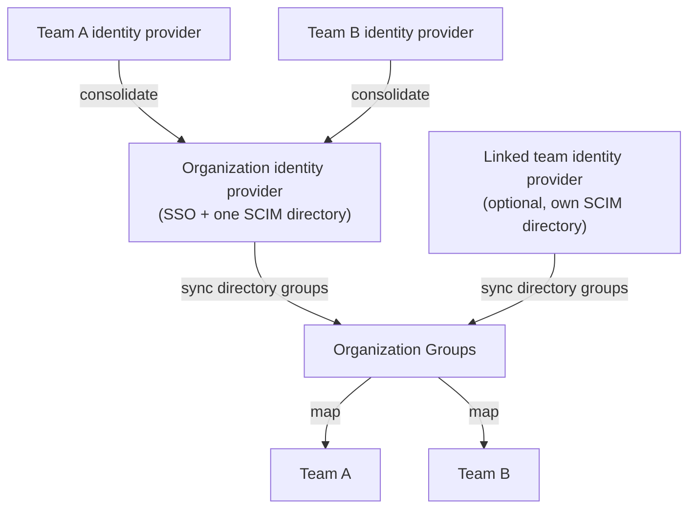

> 原文：https://cursor.com/docs/enterprise/organizations

# Organizations

Organizations 是 Enterprise 客户的顶层容器。它们位于团队之上，让你在一处管理共享身份、管理和全组织设置。

## Organizations 模型

一个 Organization 可以包含多个团队，按部门、业务单元、地区或角色创建。每个团队定义自己的成员、角色、用量视图、隐私设置和用量控制。Organization 在此之上增加共享身份、管理和全组织设置。

每个 Organization 都有一个默认团队，作为登录和路由的稳定主团队。

用户可以属于同一 Organization 中的多个团队，并在每个团队中拥有不同角色。同一个人可以在一个团队是管理员，在另一个团队是成员，并且不属于第三个团队。

## 身份模型

Organizations 在每个团队之上提供一层共享身份。在组织级别配置一次人们如何登录，以及目录数据如何流入 Cursor，而不必在每个团队重复。

### 单点登录

Organizations 支持与身份提供商的组织级 SSO。当你希望全公司使用一套登录设置时，这是推荐模型。团队级 SSO 仍支持有特定身份要求的团队。

### 使用 SCIM 的目录同步

在组织级别，SCIM 把目录组和成员关系从身份提供商同步到 Cursor。在身份提供商中启用推送组预配。每个身份提供商连接在 Organization 的 **Settings** 中都有一个 **SCIM Directory** 部分。选择 **Sync Directory** 以注册该连接的目录。身份提供商中的成员关系更改会自动同步。

管理员选择要把哪些目录组同步为[组织组](https://cursor.com/docs/enterprise/organization-groups.md)。这些组随后可以使团队成员关系与目录保持一致。

**Auto Add Users to Root Team** 默认开启。每个已同步用户都会自动加入根团队。当应由组到团队的映射控制团队成员关系时，在 Organization 的 **Settings** 中关闭它。

一个身份提供商连接支持一个 SCIM 目录，因此 Organization 通过自己的身份提供商拥有一个目录。当已关联团队运行自己的身份提供商时，Organization 仍可以从不止一个目录获取数据，因为那些连接各自可以带来自己的 SCIM 目录。

设置见 [SCIM 预配](https://cursor.com/docs/account/teams/scim.md)，完整身份模型见[身份与访问管理](https://cursor.com/docs/enterprise/identity-and-access-management.md)。

### 合并团队身份提供商

在加入 Organization 之前设置了自己的身份提供商的团队，可以合并到一套共享设置。结果是单一的组织身份提供商，而不是每个团队一份配置，成员仍使用相同的企业凭据登录。

合并是可选的。当团队确实需要自己的身份提供商时，保留单独的团队身份提供商——例如运行自己的 Okta 实例的团队。

要合并，打开 Organization 的 **Settings**，在 **Identity provider** 下找到团队身份提供商，并从其卡片上的 **⋯** 菜单选择 **Merge into default IDP**。

确认对话框会检查你这次合并的前提条件——例如先断开团队身份提供商上的 SCIM，或验证默认提供商的 SSO 覆盖将被移动的用户——并请你确认合并无法撤销。合并之后，团队身份提供商退役，其团队使用组织默认设置进行登录和目录同步。

Cursor 在后台运行合并，大型团队可能需要几分钟。运行期间，团队身份提供商的卡片显示 **Merging…** 徽章，其设置被锁定，直到合并完成。

合并后的身份模型：一个组织身份提供商为每个团队处理登录和目录同步。保留自己身份提供商的已关联团队会贡献第二个 SCIM 目录。

## 用量与合同边界

日常报告在团队级别跟踪用量。使用组织汇集账单时，团队可以从共享的已承诺池中扣减。详情见[汇集用量](https://cursor.com/docs/enterprise/pooled-usage.md)。

## 组

组织组把跨团队的用户组织成全组织队列，例如 Engineering、Contractors 或 Pilot Users。因为成员可以属于多个团队，组织管理员可以对同一队列应用设置，而不论每个用户的团队成员关系。

组也可以驱动团队成员关系。把组映射到团队，Cursor 会使该团队的成员和角色与该队列保持一致。

完整步骤见[组织组](https://cursor.com/docs/enterprise/organization-groups.md)：SCIM 同步设置、成员管理、组设置和团队映射。

## 限额与权限如何组合

用户可以同时从组织组和团队目录组获得设置，例如支出限额和允许的模型。Cursor 以“最宽松者优先”的模型来调和它们。

例如，如果用户同时在组织级组和团队中，Cursor 使用两者中较高的支出限额。

| 层级 | 它控制什么 | 多个来源如何组合 |
| --------------------- | ---------------------------------------- | -------------------------------------------------------------------------------------------- |
| 团队默认 | 人均支出上限的基线 | 仅在没有设置更具体的值时使用 |
| 团队上的单个用户 | 对一个用户的覆盖 | 优先于团队默认值和目录组设置 |
| 目录组 | SCIM 同步的支出上限和团队策略 | 支出限额取最高值；策略行为通常取最宽松者 |
| 组织组 | 组织级配额和策略 | 在组织组之间取最高值；与团队基线比较时取最高值 |

从最不宽松到最宽松自下而上：在团队级别设置最严格的默认值，然后用组织组给特定队列更宽松的设置。

## 角色

Organizations 在团队级角色之上增加组织级管理。组织管理员管理组织设置、组织成员、共享身份配置，并可以查看该 Organization 的团队。团队管理员和团队所有者管理自己团队的设置和成员。

团队管理员权限不会授予组织管理员权限，角色可以按层不同。用户可以是组织管理员，同时只是特定团队的成员。在关联到其 Organization 的每个团队上，组织管理员仍可以管理 Team MCP 服务器和团队插件变量，与团队管理员相同。参见 [Team MCP 分发](https://cursor.com/docs/mcp.md#team-mcp-distribution)。

## Organization API

对于组织级自动化，使用 [Organization API](https://cursor.com/docs/account/organizations/organization-admin-api.md)。

## 相关文档

- [Enterprise 概述](https://cursor.com/docs/enterprise.md)
- [组织组](https://cursor.com/docs/enterprise/organization-groups.md)
- [身份与访问管理](https://cursor.com/docs/enterprise/identity-and-access-management.md)
- [SCIM](https://cursor.com/docs/account/teams/scim.md)
- [Admin API](https://cursor.com/docs/account/teams/admin-api.md)
- [Billing groups](https://cursor.com/docs/account/enterprise/billing-groups.md)

---

## 站点地图

[所有文档页面概览](/llms.txt)
