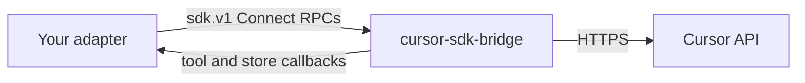

> 原文：https://cursor.com/docs/sdk/bridge

# Cursor SDK Bridge

SDK Bridge 是一个小型本地服务器，内嵌 TypeScript SDK，并通过稳定的 Connect/protobuf 协议暴露同一套 agent 接口。没有第一方 SDK 的语言，可以用它来编写 Cursor agent 的脚本。

如果你写 TypeScript 或 Python，请改为安装第一方 [TypeScript](https://cursor.com/docs/sdk/typescript.md) 或 [Python](https://cursor.com/docs/sdk/python.md) SDK。Python 已经会与随包附带的 bridge 副本通信。

协议、独立二进制文件和适配器指南都在 [`cursor/sdk-bridge`](https://github.com/cursor/sdk-bridge)。先锁定一个发布版本，再让 Cursor agent 指向该仓库，构建一个精简适配器。

Cursor 发布并支持 `sdk.v1` 契约和 bridge 二进制文件。其他语言的适配器不是第一方 SDK。除非你需要这些包没有覆盖的语言，否则优先使用 TypeScript 或 Python。

## 何时使用

| 路径                                                                     | 适用场景                                                           |
| :----------------------------------------------------------------------- | :----------------------------------------------------------------- |
| [TypeScript SDK](https://cursor.com/docs/sdk/typescript.md)              | 你在写 TypeScript 或 JavaScript。                                  |
| [Python SDK](https://cursor.com/docs/sdk/python.md)                      | 你在写 Python。                                                    |
| [SDK Bridge](https://github.com/cursor/sdk-bridge)                       | 你需要 Go、Rust、Java、C# 或其他语言。                             |
| [Cloud Agents API](https://cursor.com/docs/cloud-agent/api/endpoints.md) | 你只需要通过 HTTP 使用 Cloud Agents，不需要本地 agent 运行时。     |

Bridge 面向 SDK 作者和平台团队。应用代码应依赖 `@cursor/sdk` 或 `cursor-sdk`。

## 工作原理



你的适配器启动 `cursor-sdk-bridge`，或者连接到平台上已经在运行的实例。Bridge 绑定一个回环 HTTP/1.1 端口，并提供 `sdk.v1` 服务。因为它内嵌 `@cursor/sdk`，新的 agent 功能只需在 bridge 里落地一次。适配器升级二进制文件即可获得这些功能。

基于 HTTP/2 的经典 gRPC 无法连接。请使用 [Connect](https://connectrpc.com/docs/protocol) 客户端，或者发送正文为 protobuf 或 JSON 的普通 `POST`。

## 开始使用

### 获取 API 密钥

SDK 运行接受用户 API 密钥和服务账号 API 密钥。Team Admin API 密钥尚不支持。

- [Cursor Dashboard → API Keys](https://cursor.com/dashboard/api)
- [服务账号](https://cursor.com/docs/account/enterprise/service-accounts.md)

```bash
export CURSOR_API_KEY="your-key"
```

### 锁定一个 bridge 发布版本

每个 GitHub release tag 都与 TypeScript 和 Python SDK 的版本对应。从 [GitHub releases](https://github.com/cursor/sdk-bridge/releases) 下载适用于你平台的独立归档。每个归档解压后包含：

- `bin/cursor-sdk-bridge`（Windows 上为 `.exe`）
- `proto/sdk/v1/`（该二进制文件的契约）
- `manifest.json`

使用 `darwin`、`linux` 或 `win32`，搭配 `x64` 或 `arm64`。Windows 只有 `x64`。

同一份二进制文件也包含在 `cursor-sdk` 的 wheel 里。`pip install cursor-sdk` 之后，`cursor-sdk-bridge` 会出现在你的 `PATH` 上。

### 让 agent 指向该仓库

打开 Agent，运行这条提示词。它会让 Cursor 指向 [`cursor/sdk-bridge`](https://github.com/cursor/sdk-bridge) 和适配器构建指南。

阅读 https\://github.com/cursor/sdk-bridge，并按照 README 中的 Agent: start here 指南操作。用本仓库的主要语言构建一个精简的 Cursor SDK 适配器。覆盖从 proto/sdk/v1 生成代码、bridge 进程生命周期、流式传输、错误和回调服务器。

调试适配器代码之前，先确认二进制文件是新的：

```bash
cursor-sdk-bridge --help
```

某个 RPC 失败，而你的适配器看不出原因时，用 `--verbose` 运行 bridge（或设置 `CURSOR_SDK_BRIDGE_LOG=1`），把每个 RPC 的名称、结果、耗时和完整错误写到 stderr。请求和响应载荷永远不会被记录。

仓库里还有一份[只用 curl 的冒烟测试](https://github.com/cursor/sdk-bridge/blob/main/docs/smoke-test.md)，它会演练启动、`Ping`、`Me`、`CreateAgent` 和 `Send`，不需要任何适配器代码。

## 适配器形态

适配器是一个库，其他开发者安装它时不必知道 bridge 的存在。第一方 SDK 都收敛到这种形态：

| 部分                      | 作用                                                                                                                    |
| :------------------------ | :---------------------------------------------------------------------------------------------------------------------- |
| **Bridge 管理器**         | 查找或启动二进制文件，完成就绪行握手，并把它关掉。允许连接到已有端点。                                                 |
| **传输**                  | 通过 HTTP/1.1 连接：一元 POST 和流式响应，每次调用都带 bearer 认证。                                                   |
| **客户端**                | 面向 agent、run、模型和仓库的低层类型化 RPC。                                                                           |
| **Agent 与 Run 句柄**     | 公开 API：创建、发送、流式接收事件、等待和取消。                                                                        |
| **错误**                  | 把 Connect 错误码和 `sdk.v1` 错误详情映射到你所用语言中的异常或结果类型。                                              |
| **回调服务器**            | 可选的回环服务器，让用户能用你的语言定义自定义工具和存储。                                                              |

请提供一个单提示词辅助函数（创建、发送、等待、关闭），以及上下文管理器或 RAII 形式，这样 bridge 进程就不会泄漏。

## 协议

线路契约是 protobuf 包 `sdk.v1`：

| Proto                                    | 作用                                                                       |
| :--------------------------------------- | :------------------------------------------------------------------------- |
| `sdk_agent_service.proto`                | 创建和恢复 agent，发送提示词，流式传输 run、产物和用量。                   |
| `sdk_cursor_service.proto`               | 身份、模型和仓库。                                                         |
| `sdk_bridge_control_service.proto`       | Ping、版本、关闭，以及工具回调注册。                                       |
| `sdk_custom_tool_callback_service.proto` | 由你的适配器托管。Bridge 调用它来运行用户定义的工具。                      |
| `sdk_store_callback_service.proto`       | 由你的适配器托管，用于自定义 agent 存储。                                  |
| `sdk_messages.proto`                     | 共享消息，以及 run 流的信封。                                              |
| `sdk_errors.proto`                       | 结构化错误详情。                                                           |

把 `proto/` 放进仓库时不要改动它。Cursor 会在每次 SDK 发布时重新生成这些文件。

细节都在仓库里：

- [生命周期与握手](https://github.com/cursor/sdk-bridge/blob/main/docs/protocol.md)
- [服务](https://github.com/cursor/sdk-bridge/blob/main/docs/services.md)
- [流式传输](https://github.com/cursor/sdk-bridge/blob/main/docs/streaming.md)
- [错误](https://github.com/cursor/sdk-bridge/blob/main/docs/errors.md)
- [Curl 冒烟测试](https://github.com/cursor/sdk-bridge/blob/main/docs/smoke-test.md)
- [版本管理](https://github.com/cursor/sdk-bridge/blob/main/docs/versioning.md)

## 认证

两套分开的凭据：

1. **Cursor API 密钥。** 设置 `options.api_key`，用于创建、恢复，以及 `ListModels` 这类目录调用。同时在 bridge 进程的环境中导出 `CURSOR_API_KEY`。目录调用需要每次调用传入的密钥。
2. **Bridge bearer token。** 在就绪行握手期间为每个进程生成。每个 RPC（包括流）都要发送 `Authorization: Bearer <token>`。Bridge 默认监听 `127.0.0.1`。

启动标志、就绪行和关闭顺序见 [protocol.md](https://github.com/cursor/sdk-bridge/blob/main/docs/protocol.md)。

## 版本管理

`sdk.v1` 只做追加式变更。已有字段不会重新编号，也不会被复用。破坏性变更会以 `sdk.v2` 与 `v1` 并行发布。

把代码生成锁定到某个 release tag，并优先使用 `manifest.json` 里 `sdkVersion` 与之匹配的 bridge。较旧的适配器仍然可以对接较新的 bridge。在你重新生成之前，新的 RPC 保持不可见。

调用 `SdkBridgeControlService.GetVersion`，以便在运行时按 `bridge_version`、`protocol_version` 或 `capabilities`（例如 `agent.usage`）做门控。

## 支持

- **受支持：** 已发布的 `sdk.v1` proto、独立的 `cursor-sdk-bridge` 二进制文件，以及第一方 TypeScript 和 Python SDK。
- **由你负责：** 基于 bridge 构建的社区或内部适配器。这些库的版本管理、支持和安全审查由你负责。

SDK 运行遵循与 IDE 和 Cloud Agents 相同的定价、请求池和 Privacy Mode 规则。花费会显示在[用量仪表板](https://cursor.com/dashboard/usage)的 SDK 标签下。

## 相关

- [TypeScript SDK](https://cursor.com/docs/sdk/typescript.md)
- [Python SDK](https://cursor.com/docs/sdk/python.md)
- [Cloud Agents API](https://cursor.com/docs/cloud-agent/api/endpoints.md)
- [SDK 发布说明](https://cursor.com/docs/release-notes/sdk.md)
- [GitHub 上的 `cursor/sdk-bridge`](https://github.com/cursor/sdk-bridge)


---

## 站点地图

[所有文档页面概览](/llms.txt)
